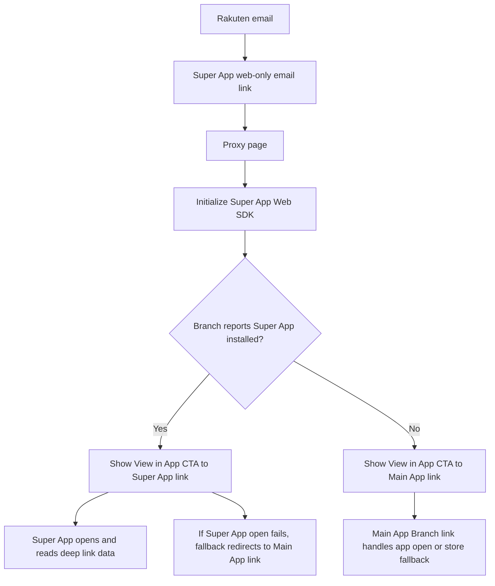
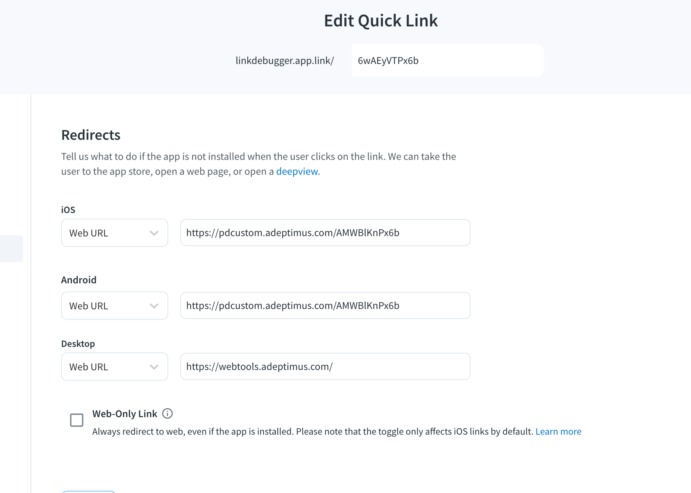
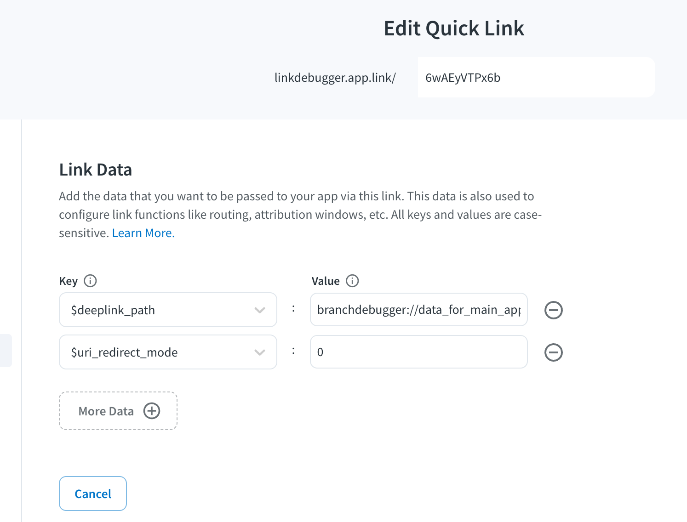
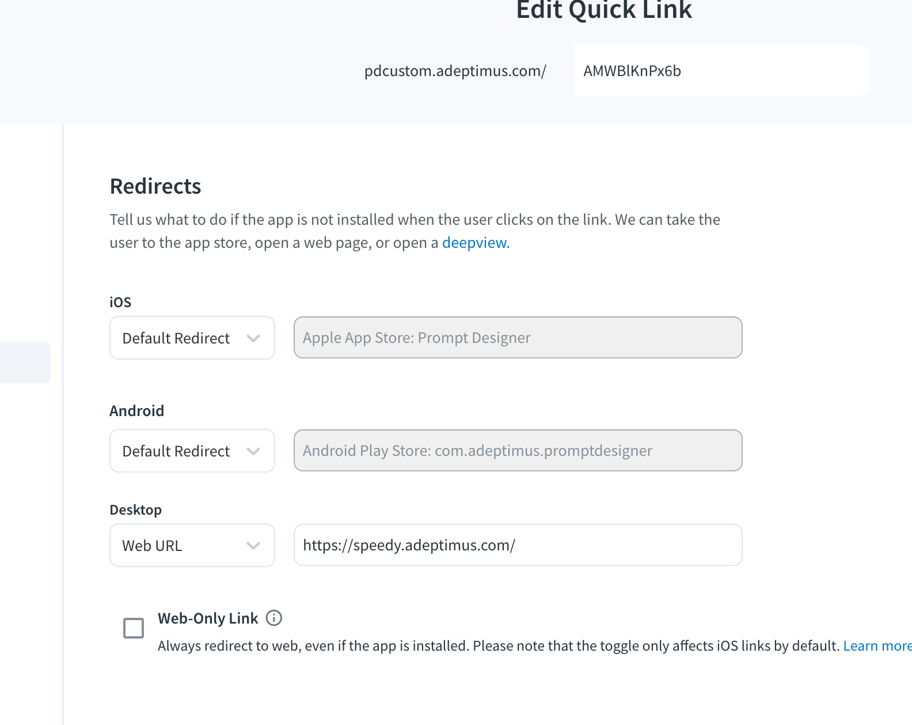
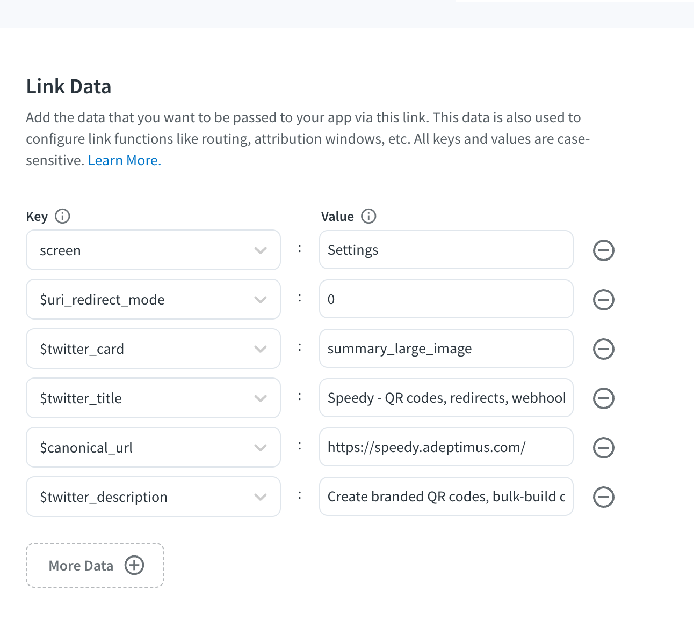

# Rakuten / Super App Branch Routing Proposal

I used two test apps to validate the proposed flow:

- **Link Debugger** is acting as the **Super App**.
- **Prompt Designer** is acting as Rakuten's **Main App**.

The goal is to model a flow where Rakuten can send a user from email to a proxy page, let the proxy page decide whether the Super App appears to be installed, and then show one clear CTA that routes the user to the right Branch link.

## Considerations
1. Rakuten will be using Their own Iterbale and CTAs with emails that link's to Super App. 
2. Super App will be primary app app to launch the app. 
3. 

## Proposed Flow

1. Rakuten places the Super App's web-only Branch link in the email.
2. That web-only link sends the user to the proxy page.
3. The proxy page initializes the Super App's Branch Web SDK.
4. The proxy page checks whether Branch reports that the user has the Super App.
5. If the Super App is detected, the CTA points to the Super App Branch link.
6. If the Super App is not detected, the CTA points to Rakuten's Main App Branch link.

## Link Inventory

| Link | URL | Test App / Role | Purpose | Notes |
| --- | --- | --- | --- | --- |
| Super App web-only email link | `https://linkdebugger-web.app.link/e/Aq8cmXJNx6b` | Link Debugger / Super App | Link Rakuten places in email | Sends the user to the proxy page instead of trying to open the app directly. |
| Proxy page | `https://mzeeshanhussain.github.io/BranchCode/branch-dual-init-payload.html` | Hosted test page | Runs the Super App Web SDK and chooses the CTA destination | Shows one common CTA: `View in App`. |
| Super App CTA link | `https://linkdebugger.app.link/6wAEyVTPx6b` | Link Debugger / Super App | Used when the Super App is detected | Must be configured defensively so failed app opens redirect to the Main App link. |
| Main App CTA link | `https://pdcustom.adeptimus.com/AMWBlKnPx6b` | Prompt Designer / Rakuten Main App | Used when the Super App is not detected | Normal Quick Link with app-store, play-store, and desktop redirects. |

## Proxy Page Behavior

The proxy page should keep the user experience simple. It should show both raw links for testing if needed, but the primary user-facing action should be one CTA named **View in App**.

The page initializes the Super App's Web SDK and uses the returned Branch payload to decide which link the CTA should use:

| Branch result | CTA destination |
| --- | --- |
| Super App detected | `https://linkdebugger.app.link/6wAEyVTPx6b` |
| Super App not detected | `https://pdcustom.adeptimus.com/AMWBlKnPx6b` |

Important caveat: Branch `has_app` can be stale or inferred, especially during repeated install/uninstall testing. Because of that, the Super App CTA link still needs defensive fallback configuration in case Branch thinks the app is installed but the app cannot actually open.

## Super App Link Configuration

The Super App CTA link is:

`https://linkdebugger.app.link/6wAEyVTPx6b`

This link should be configured so all failed app-open paths redirect to the Main App link:

`https://pdcustom.adeptimus.com/AMWBlKnPx6b`

Required configuration:

- iOS redirect should point to the Main App Branch link.
- Android redirect should point to the Main App Branch link.
- Link data should include the deep link data the Super App understands for routing to the Main App experience.
- `$uri_redirect_mode` should be set to `0`.
- Analytics tags should be set based on what Rakuten wants to report on.
- If Super's Branch app will send webhook data back to Rakuten's warehouse, analytics tags should be designed so those webhooks can be filtered correctly.

The reason for setting this defensively is to avoid a bad user experience when Branch reports that the Super App is installed, but the app was actually uninstalled or cannot be opened. I saw this while repeatedly installing and uninstalling apps during testing. Real users may hit it less often, but the fallback should still be safe.

## Main App Link Configuration

The Main App CTA link is:

`https://pdcustom.adeptimus.com/AMWBlKnPx6b`

This can be a normal Branch Quick Link for Rakuten's Main App. It should use standard redirects to the App Store, Play Store, and desktop web destination as needed.

Analytics tags are important on this link too because they determine how Rakuten can measure the email campaign, the proxy flow, app opens, installs, and any downstream webhook filtering.

## Test Checklist

| Scenario | Expected behavior |
| --- | --- |
| Super App installed | Proxy page CTA points to the Super App link. Tapping **View in App** should open the Super App and pass the configured deep link data. |
| Super App not installed | Proxy page CTA points directly to the Main App link. |
| Branch reports Super App installed, but app open fails | Super App link redirects to the Main App link because its iOS and Android redirects are configured to the Main App link and `$uri_redirect_mode` is `0`. |
| Main App installed | Main App link should open the Main App. |
| Main App not installed | Main App link should route to the correct app-store or web fallback. |
| Desktop user | Proxy page should still render cleanly, and desktop redirects should go to the configured web destinations. |

## Screenshots

### Super App CTA Link Redirects

This shows the Super App test link configured with iOS and Android web redirects to the Main App link.

### Super App CTA Link Data

This shows the Super App test link carrying deep link data and `$uri_redirect_mode = 0`.

### Main App Link Redirects

This shows the Main App test link configured as a normal Quick Link with app-store and desktop redirects.

### Main App Link Data

This shows example Main App link data and social metadata. Final analytics and metadata should match Rakuten's reporting requirements.

## Open Items

- Confirm the production Super App Branch key and link domain.
- Confirm the production Rakuten Main App Branch link and fallback destinations.
- Confirm the exact deep link keys the Super App expects for routing into the Main App experience.
- Confirm analytics tags required for reporting and webhook filtering.
- Confirm whether the proxy page should keep the raw test links visible or only show the single **View in App** CTA.
